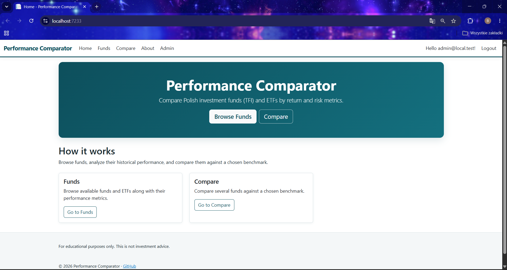
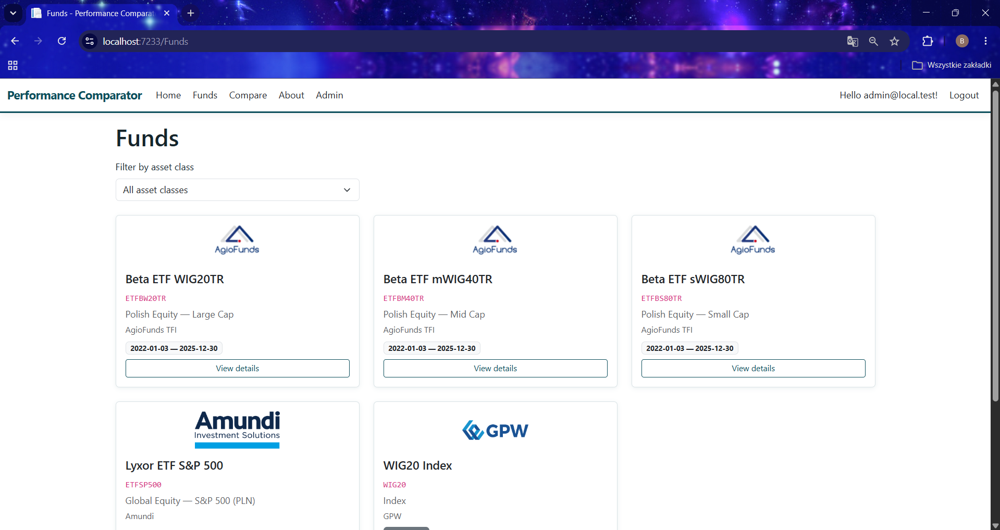
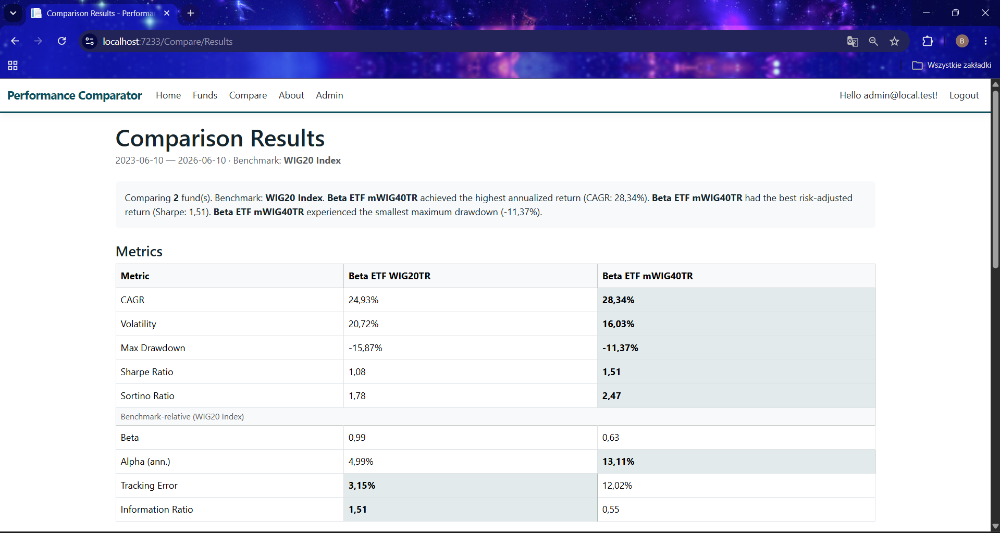
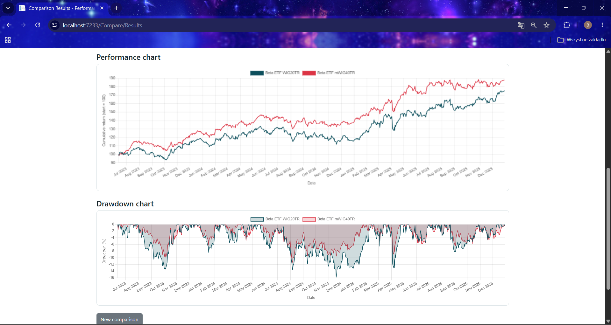
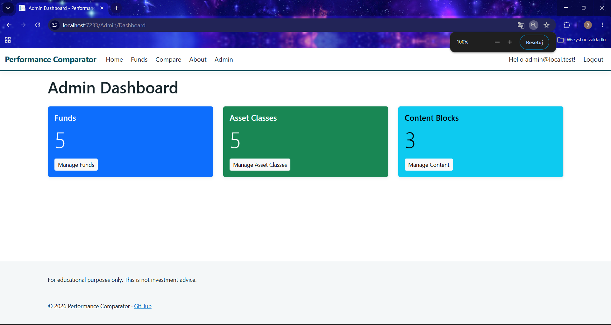

# Performance Comparator

A web application for comparing Polish investment funds (TFI) and ETFs by return and risk metrics. You can browse funds, analyze their historical performance and compare them against a chosen benchmark. An admin panel lets you manage funds and import price history (NAV) from CSV files. Built with ASP.NET Core MVC on .NET 10.

---

## Screenshots


*Home page*


*Funds list*


*Fund comparison — metrics table*


*Fund comparison — charts*


*Admin panel*

---

## Features

- Browse funds and ETFs, filtered by asset class
- Fund details page with key metrics and a cumulative return chart
- Compare 1–4 funds against a chosen benchmark
- Metrics: cumulative return, CAGR, volatility, maximum drawdown, Sharpe, Sortino, beta, alpha, tracking error, information ratio
- Interactive charts: cumulative return and drawdown (Chart.js)
- Admin panel: create, edit and delete asset classes and funds
- NAV history import from CSV files (Stooq format and a simple format)
- Fund logo upload
- Editable page content (text blocks managed from the admin panel)
- Authentication and authorization (Admin role)

---

## Tech stack

| Technology | Version / notes |
|---|---|
| .NET | 10 |
| ASP.NET Core MVC | multi-page app, server-side rendering (Razor) |
| Entity Framework Core | ORM, data access |
| SQLite | database (`app.db` file) |
| ASP.NET Core Identity | authentication and authorization (Admin role) |
| Bootstrap | 5 (responsive UI) |
| Chart.js | 4 (interactive charts) |
| xUnit | unit tests |

---

## Requirements

- **.NET 10 SDK** ([download](https://dotnet.microsoft.com/download))
- Visual Studio 2026 (recommended) **or** any editor + .NET CLI
- Git

---

## Running locally

### Option A — Visual Studio 2026 (recommended)

1. Clone the repository:
```
   git clone https://github.com/bartoszopiola/performance-comparator
```
2. Open `PerformanceComparator.slnx` in Visual Studio.
3. Open the **Package Manager Console**
   (`Tools → NuGet Package Manager → Package Manager Console`).
4. Make sure **Default project** is set to `PerformanceComparator`, then create the database:
```
   Update-Database
```
5. Press **F5** to run the app. The browser opens automatically.

### Option B — command line (.NET CLI)

1. Clone the repository and go to its folder:
```
   git clone https://github.com/bartoszopiola/performance-comparator
   cd performance-comparator
```
2. Restore dependencies:
```
   dotnet restore
```
3. Create the database (requires the `dotnet-ef` tool; if you don't have it:
   `dotnet tool install --global dotnet-ef`):
```
   dotnet ef database update --project PerformanceComparator
```
4. Run the app:
```
   dotnet run --project PerformanceComparator
```
5. Open the address printed in the console (e.g. `https://localhost:7233`).

> **Note:** after the first run the database is **empty** (no funds or prices). The `app.db`
> file is not part of the repository — it is created locally by `Update-Database`. Only the
> admin account and the page texts are created automatically. To fill the app with data,
> follow [Importing data](#importing-data) below.

---

## Admin login

The admin account is created automatically on first run:

| Field | Value |
|---|---|
| Email | `admin@local.test` |
| Password | `Admin123!` |

> These are demo credentials for local use only. You can override them in
> `appsettings.Development.json` under `AdminSeed` (keys `Email` and `Password`).

---

## Importing data

The `samples/` folder contains ready-to-use CSV files with price history (downloaded from Stooq) for a set of Polish instruments. To load them:

### Step 1 — log in as admin

Open the app, click **Login** (top right) and sign in with the admin credentials above.

### Step 2 — create asset classes

Go to **Admin → Manage Asset Classes → Create New** and create these classes:

- `Polish Equity — Large Cap`
- `Polish Equity — Mid Cap`
- `Polish Equity — Small Cap`
- `Global Equity — S&P 500 (PLN)`
- `Index`

### Step 3 — create funds

Go to **Admin → Manage Funds → Create New** and create the funds from this table:

| Name | Symbol | Asset Class | Provider | Currency | Is Benchmark |
|---|---|---|---|---|---|
| Beta ETF WIG20TR | ETFBW20TR | Polish Equity — Large Cap | AgioFunds TFI | PLN | no |
| Beta ETF mWIG40TR | ETFBM40TR | Polish Equity — Mid Cap | AgioFunds TFI | PLN | no |
| Beta ETF sWIG80TR | ETFBS80TR | Polish Equity — Small Cap | AgioFunds TFI | PLN | no |
| Lyxor ETF S&P 500 | ETFSP500 | Global Equity — S&P 500 (PLN) | Amundi | PLN | no |
| WIG20 Index | WIG20 | Index | GPW | PLN | **yes** |

### Step 4 — upload the CSV files

For each fund, click **NAV** on the funds list and upload the matching file from `samples/`:

| Fund | File in `samples/` |
|---|---|
| Beta ETF WIG20TR | `etfbw20tr.csv` |
| Beta ETF mWIG40TR | `etfbm40tr.csv` |
| Beta ETF sWIG80TR | `etfbs80tr.csv` |
| Lyxor ETF S&P 500 | `etfsp500.csv` |
| WIG20 Index | `wig20.csv` |

After each upload you'll see a message with the number of records added.

### (Optional) Downloading fresh data from Stooq

To get up-to-date data yourself, open the instrument's page, e.g.:
```
https://stooq.pl/q/d/?s=etfbw20tr.pl
```
Scroll to the bottom and click **"Pobierz dane w pliku CSV"** ("Download data as CSV").

> **Note:** direct API links (`/q/d/l/?s=...`) may require an API key — use the instrument
> page and the button at the bottom instead.

Supported CSV formats:
- **Stooq:** `Data,Otwarcie,Najwyzszy,Najnizszy,Zamkniecie,Wolumen` (the `Zamkniecie` / close column is used)
- **Simple:** `date,value` (or `date,nav`)

---

## Project structure

```
PerformanceComparator/
├── Areas/Admin/          # admin panel (controllers, views)
├── Controllers/          # public controllers (Home, Funds, Compare)
├── Data/                 # ApplicationDbContext, SeedData, migrations
├── Models/               # EF Core entities (Fund, AssetClass, NavRecord, ContentBlock)
├── Services/             # calculation logic (calculators, importer, comparison)
├── ViewModels/           # view models
├── Views/                # Razor views
├── wwwroot/              # CSS, JS (Chart.js), uploaded logos
└── Program.cs            # app configuration (DI, pipeline)

PerformanceComparator.Tests/   # unit tests (xUnit)
samples/                       # sample CSV files with prices (for import)
docs/                          # documentation and screenshots
```

---

*Educational project. Data for educational purposes only — not investment advice.*